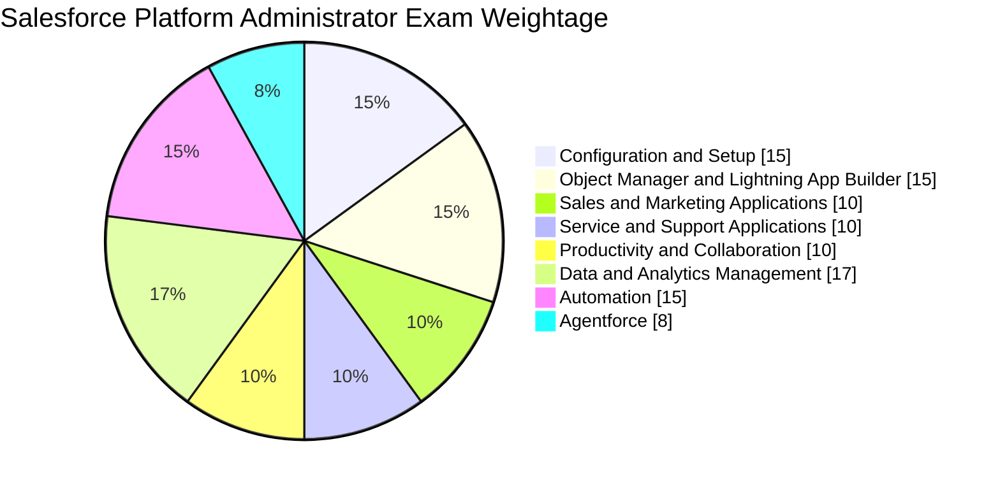
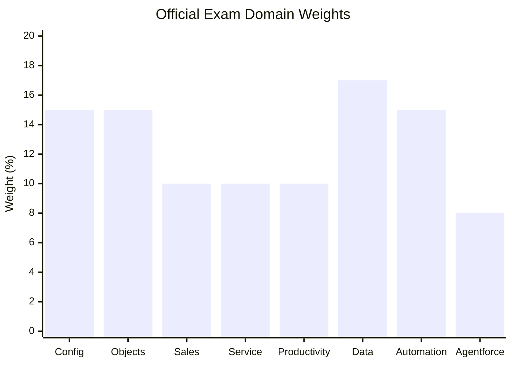
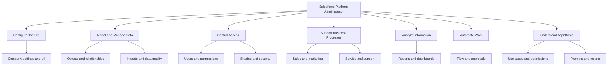
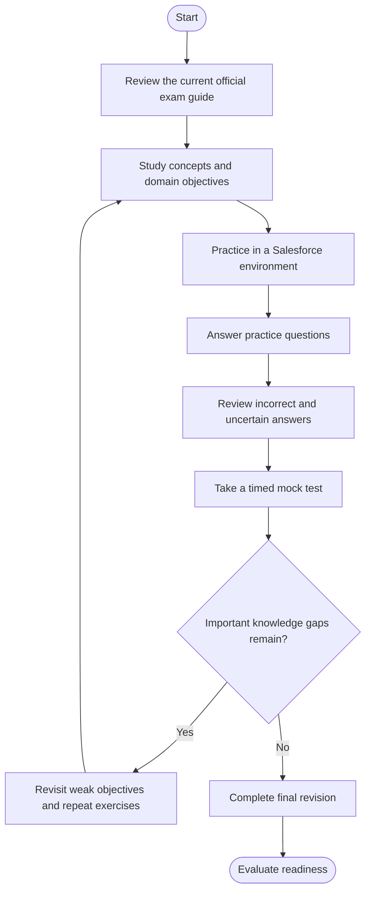
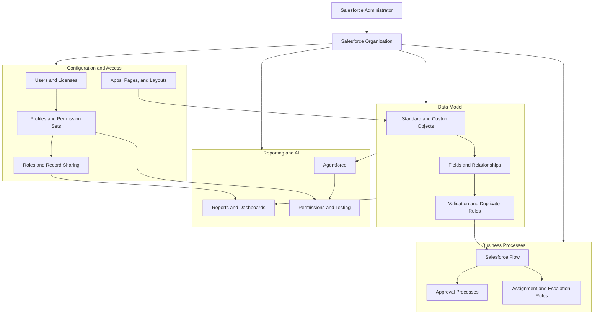
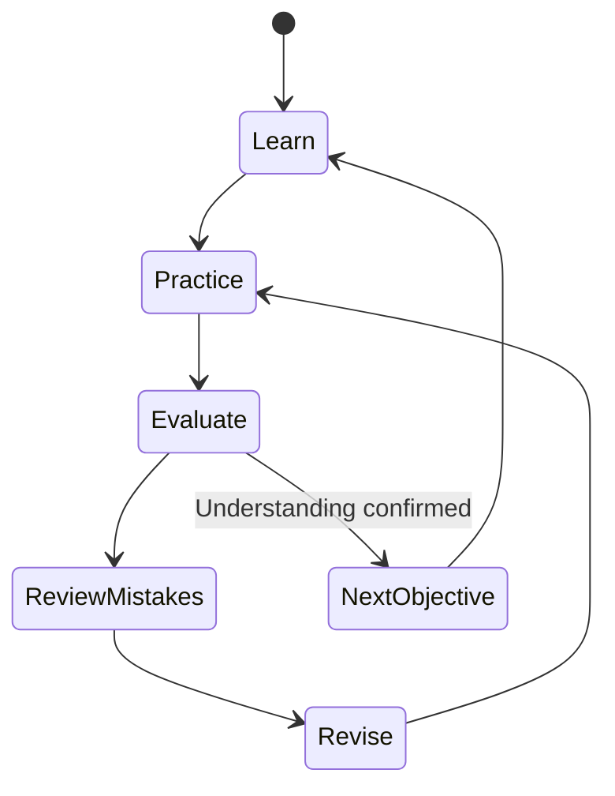
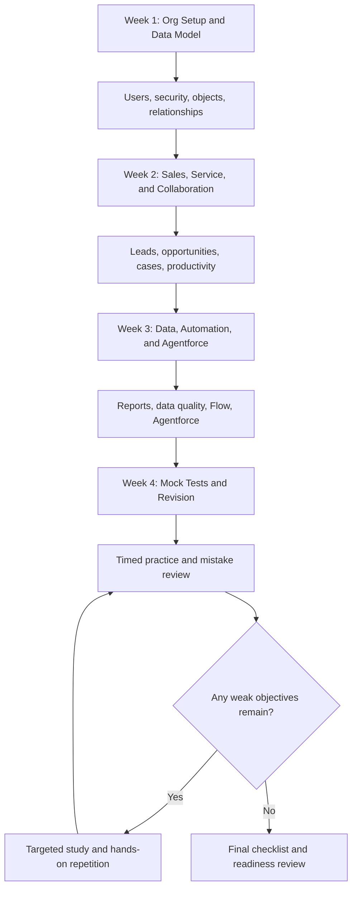

# Salesforce Certified Platform Administrator (Plat-Admn-201) Study Guide

A practical, exam-focused study guide for the **Salesforce Certified Platform Administrator** certification. This repository organizes the exam objectives into a structured learning path covering Salesforce configuration, user access, object relationships, Sales and Service applications, data management, reporting, automation, and Agentforce fundamentals.

The aim is to help learners connect Salesforce concepts to real administration tasks. Use this guide alongside official Salesforce exam documentation, Trailhead learning paths, and hands-on practice in a Salesforce environment.

For supplementary study materials and practice questions, you can also explore [CertsGate](https://certsgate.com/).

## Table of Contents

- [Overview](#overview)
- [About the Certification](#about-the-certification)
- [Who Should Prepare?](#who-should-prepare)
- [Exam Format and Logistics](#exam-format-and-logistics)
- [Official Exam Objectives](#official-exam-objectives)
- [Exam Domain Weightage](#exam-domain-weightage)
- [Conceptual Skills Map](#conceptual-skills-map)
- [Preparation Flowchart](#preparation-flowchart)
- [Salesforce Administration Architecture](#salesforce-administration-architecture)
- [Study and Revision Cycle](#study-and-revision-cycle)
- [Step-by-Step Preparation Guide](#step-by-step-preparation-guide)
- [Suggested Study Roadmap](#suggested-study-roadmap)
- [Practice Questions and Mock Tests](#practice-questions-and-mock-tests)
- [Hands-On Projects](#hands-on-projects)
- [Common Preparation Mistakes](#common-preparation-mistakes)
- [Career Relevance](#career-relevance)
- [Frequently Asked Questions](#frequently-asked-questions)
- [Official Learning Resources](#official-learning-resources)
- [Additional Study Resources](#additional-study-resources)
- [About CertsGate](#about-certsgate)

## Overview

Salesforce administrators configure and maintain the platform so that users can work efficiently while business data remains organized and appropriately protected. Their responsibilities may include managing users, controlling access, creating fields and page layouts, improving data quality, building reports, and automating routine business processes.

The Platform Administrator exam tests knowledge across these responsibilities. The current blueprint also includes Agentforce, reflecting the need for administrators to understand foundational AI capabilities, appropriate use cases, permissions, and basic agent testing.

This Salesforce Platform Administrator study guide combines the published exam objectives with independent study recommendations, diagrams, practical project ideas, and original review questions.

## About the Certification

The Salesforce Certified Platform Administrator credential is intended for professionals who understand how to maintain a Salesforce organization, respond to common business requirements, and configure platform features for business users.

Salesforce recommends a combination of practical experience, official training, and self-study. Its exam guide describes candidates as people who can maintain a Salesforce org, manage access, and apply the platform's configuration capabilities to common administrative tasks.

### Recommended background

Before preparing, become familiar with:

- Salesforce navigation and the Lightning Experience interface.
- Users, roles, profiles, permission sets, and record access.
- Standard and custom objects, fields, and relationships.
- Leads, accounts, contacts, opportunities, and cases.
- Reports, dashboards, and data imports.
- Salesforce Flow and declarative automation.
- Basic data quality and security concepts.

The Salesforce exam guide recommends at least six months of Salesforce Platform Administrator experience. Candidates who have not worked in an org can build familiarity through Trailhead and hands-on exercises.

## Who Should Prepare?

This certification may be useful for:

- Aspiring Salesforce administrators.
- CRM administrators who manage users and business processes.
- Sales operations and service operations professionals.
- Business analysts who configure Salesforce to meet requirements.
- Support specialists who work with cases, queues, and service processes.
- Salesforce professionals who want to strengthen their platform fundamentals.

If you are new to Salesforce, start with navigation, data modeling, and user management before moving into more complex reporting and automation scenarios.

## Exam Format and Logistics

Salesforce publishes exam logistics through its official exam guide and certification resources.

| Detail | Information |
|---|---|
| Official credential name | Salesforce Certified Platform Administrator |
| Code used in the supplied listing | Plat-Admn-201 |
| Certification provider | Salesforce |
| Exam duration | 105 minutes in the published exam guide |
| Question format | Multiple-choice and multiple-select |
| Published question count | 60 scored questions, with up to 5 additional unscored questions |
| Published passing score | 68% for English and 65% for Japanese in the referenced exam guide |
| Delivery | Proctored exam; online and test-center options are described in Salesforce's exam documentation |
| Prerequisite | None listed in the referenced exam guide |

**Important version note:** Salesforce refreshed the Platform Administrator exam blueprint effective December 15, 2025. The linked exam guide's logistics section may display older release-alignment information. Confirm the current question count, language availability, passing requirements, delivery options, and exam version through the official exam guide and registration page before scheduling.

Official references:

- [Salesforce Certified Platform Administrator credential](https://trailhead.salesforce.com/en/credentials/platformadministrator)
- [Salesforce Certified Platform Administrator Exam Guide](https://help.salesforce.com/s/articleView?id=005298966&type=1&language=en_US)
- [Salesforce's January 2026 exam update](https://admin.salesforce.com/blog/2026/what-the-salesforce-certified-platform-administrator-exam-update-means-for-admins)

## Official Exam Objectives

The current published blueprint contains eight domains. The following checklist summarizes their focus and provides a practical way to track preparation.

### 1. Configuration and Setup — 15%

- [ ] Understand company settings, fiscal years, business hours, and currency settings.
- [ ] Configure declarative user-interface settings and app navigation.
- [ ] Understand user creation, licenses, locales, and user deactivation.
- [ ] Review organization security controls and login settings.
- [ ] Apply sharing settings, roles, groups, and organization-wide defaults.
- [ ] Distinguish profiles, permission sets, permission set groups, and muting permissions.

### 2. Object Manager and Lightning App Builder — 15%

- [ ] Understand standard and custom objects.
- [ ] Compare lookup, master-detail, and junction-object relationships.
- [ ] Create and customize fields.
- [ ] Understand page layouts, record types, and business processes.
- [ ] Configure Lightning pages and actions.
- [ ] Understand the consequences of deleting fields or changing relationships.

### 3. Sales and Marketing Applications — 10%

- [ ] Understand the lead and opportunity lifecycle.
- [ ] Review lead conversion and opportunity processes.
- [ ] Understand lead assignment rules and campaign management.
- [ ] Explore forecasting and territory-management concepts.
- [ ] Understand relevant sales productivity features.

### 4. Service and Support Applications — 10%

- [ ] Understand case management.
- [ ] Configure or explain queues and case assignment rules.
- [ ] Review support processes and case escalation rules.
- [ ] Understand case auto-response rules and related service features.

### 5. Productivity and Collaboration — 10%

- [ ] Understand tasks and events.
- [ ] Review Chatter groups and collaboration features.
- [ ] Understand Salesforce mobile app configuration.
- [ ] Identify common AppExchange use cases.
- [ ] Understand the difference between managed and unmanaged packages.

### 6. Data and Analytics Management — 17%

- [ ] Understand importing, updating, exporting, transferring, and backing up data.
- [ ] Compare the Data Import Wizard and Data Loader.
- [ ] Understand validation rules, matching rules, and duplicate rules.
- [ ] Create reports and select suitable report types.
- [ ] Understand report formulas, buckets, grouping, and joined reports.
- [ ] Configure dashboards, filters, refresh schedules, and dynamic dashboards.
- [ ] Understand how record access affects report visibility.

### 7. Automation — 15%

- [ ] Identify when to use the appropriate automation feature.
- [ ] Understand screen flows, record-triggered flows, and autolaunched flows.
- [ ] Review Flow configuration, execution, and order of execution.
- [ ] Understand approval processes.
- [ ] Review assignment and escalation rules.
- [ ] Troubleshoot common automation behavior.

### 8. Agentforce — 8%

- [ ] Understand Agentforce capabilities and suitable use cases.
- [ ] Recognize when AI is appropriate for a business scenario.
- [ ] Understand security and agent permissions.
- [ ] Review prompts and instructions in Agent Builder.
- [ ] Understand basic testing and conversation preview.
- [ ] Consider trusted data, appropriate access, and guardrails.

The checklist summarizes the current blueprint; consult the [official exam guide](https://help.salesforce.com/s/articleView?id=005298966&type=1&language=en_US) for the detailed objective wording.

## Exam Domain Weightage

Salesforce's updated blueprint, effective December 15, 2025, publishes the following domain percentages. These are official exam weightings, not suggested allocations invented for this repository.

### Official domain distribution

### Domain weight comparison

| Domain | Weight |
|---|---:|
| Configuration and Setup | 15% |
| Object Manager and Lightning App Builder | 15% |
| Sales and Marketing Applications | 10% |
| Service and Support Applications | 10% |
| Productivity and Collaboration | 10% |
| Data and Analytics Management | 17% |
| Automation | 15% |
| Agentforce | 8% |
| **Total** | **100%** |

**Study implication:** Data and Analytics Management has the largest published weight at 17%. Configuration, Object Manager, and Automation each account for 15%. Agentforce has the smallest share at 8%, but it should not be skipped because it is a named exam domain.

Source: [Salesforce's updated Platform Administrator exam blueprint](https://admin.salesforce.com/blog/2026/what-the-salesforce-certified-platform-administrator-exam-update-means-for-admins).

## Conceptual Skills Map

The exam spans configuration, data, access control, business applications, automation, analytics, and AI. This independent skills map shows how these subjects relate; it is not an additional official exam blueprint.

## Preparation Flowchart

Use this workflow to move from reading the objectives to testing your readiness.

The purpose of the loop is to connect mistakes with specific objectives. For example, if you miss a question about record access, revisit organization-wide defaults, roles, sharing rules, and permission settings rather than memorizing the answer.

## Salesforce Administration Architecture

This conceptual diagram shows how common administration responsibilities fit together in a Salesforce organization. It is an educational overview, not an official architecture diagram or a requirement to configure every feature.

### How to use this diagram

- **Configuration and access:** Understand how user settings, permissions, and record sharing affect what people can see and do.
- **Data model:** Learn how objects, fields, relationships, and validation rules support reliable records.
- **Business processes:** Know when Flow, approval processes, or assignment rules are appropriate.
- **Reporting:** Understand how data, report types, filters, and access settings influence results.
- **Agentforce:** Learn the foundational role of permissions, suitable use cases, and basic agent testing.

These areas are interconnected. A flow can be configured correctly but still fail to meet a business requirement if the data model or access configuration is unsuitable.

## Study and Revision Cycle

Preparation is an iterative process. Read a topic, apply it, test your understanding, and revisit the parts that remain unclear.

For each objective:

1. Read the relevant Salesforce documentation or Trailhead material.
2. Explain the feature in your own words.
3. Configure or inspect it in a practice org.
4. Answer review questions.
5. Record mistakes and uncertain assumptions.
6. Repeat the exercise until you can explain the result confidently.

## Step-by-Step Preparation Guide

### Step 1: Start with org configuration and security

Review company settings, user administration, profiles, permission sets, roles, and sharing settings.

Make sure you can distinguish between **object permissions**, **field-level security**, and **record-level access**. These solve different access-control problems and should not be treated as interchangeable.

Practice deciding which access mechanism fits a requirement while following the principle of least privilege.

### Step 2: Learn the data model

Study standard and custom objects, fields, lookup relationships, master-detail relationships, and junction objects.

For each relationship type, understand what it connects and what implications it has for record behavior and administration. Practice designing a simple data model for a fictional business—for example, accounts, contacts, opportunities, and a custom service-request object.

### Step 3: Review Sales and Service applications

Learn the lifecycle of leads and opportunities, including conversion and assignment. Understand how campaigns support marketing activities.

For service scenarios, study cases, queues, assignment rules, escalation rules, and auto-response behavior. Focus on choosing the right feature for the business requirement described in a scenario.

### Step 4: Practice data management and analytics

Data and Analytics Management is the largest domain in the updated blueprint.

Practice importing sample records, validating fields, identifying duplicate data, and understanding when Data Loader or the Data Import Wizard is appropriate.

Then build reports and dashboards. Experiment with report types, grouping, filters, formulas, charts, dashboard filters, and record visibility. When a report looks incorrect, verify the data, filters, report type, and user's access before changing the configuration.

### Step 5: Understand Salesforce Flow

Study screen flows, record-triggered flows, and autolaunched flows. Learn what each type is designed to do and how to identify an appropriate solution for a scenario.

Use a small test org to build a flow that responds to a simple business event. Test normal conditions, missing values, and unexpected inputs. Review how the flow behaves and how you would troubleshoot it.

Also study approval processes and the relevant assignment and escalation rules in the exam outline.

### Step 6: Prepare for Agentforce

The updated exam includes an 8% Agentforce domain. Candidates should understand foundational capabilities and use cases rather than assume they need to become advanced AI developers.

Review:

- When an AI agent is an appropriate solution.
- How agent permissions affect access.
- Why trusted data and security controls matter.
- How prompts and instructions are maintained in Agent Builder.
- How basic testing and conversation preview can help identify problems.

Do not focus only on the AI section at the expense of the core administration domains.

### Step 7: Consolidate with practice tests

After reviewing the objectives, take a timed practice test and record the topics that caused mistakes.

For each missed question, find the related objective and return to the source material. Repeat the test only after reviewing the underlying concepts, so your improvement reflects understanding rather than answer memorization.

## Suggested Study Roadmap

The following four-week schedule is an independent recommendation, not an official Salesforce timetable. Adjust it according to your experience and study availability.

| Week | Focus | Suggested outcome |
|---|---|---|
| 1 | Configuration, access, objects, relationships | Explain how the org, data model, and permissions work together |
| 2 | Sales, Service, productivity, collaboration | Identify appropriate features for common business scenarios |
| 3 | Data and analytics, Flow, approvals, Agentforce | Practice reporting, automation, and foundational AI concepts |
| 4 | Practice tests and weak-area review | Explain answers and revisit any objectives that remain unclear |

Because Data and Analytics Management carries the largest published weighting, make sure it receives adequate study time. Still cover every domain, including Agentforce.

## Practice Questions and Mock Tests

Practice questions are useful for testing your understanding, but they should not replace official documentation or hands-on work.

Salesforce provides official Trailhead certification-preparation content, including learning modules, interactive review material, and a curated preparation Trailmix. Independent resources such as [CertsGate](https://certsgate.com/) can provide supplementary opportunities to review concepts and identify weak areas.

### Original review questions

The following questions are original educational examples written for this repository. They are not official Salesforce exam questions.

**Question 1: Record access**

A user needs permission to edit a particular object, but should not automatically see every record of that object. Which approach best reflects Salesforce's access model?

A. Use only the app navigation settings.  
B. Consider object permissions separately from record-level sharing.  
C. Give the user full administrator access.  
D. Hide the object from the navigation menu.

**Answer: B.** Object permissions determine what actions a user can perform on an object, while record-level access determines which records are available to that user.

**Question 2: Object relationships**

A business needs to represent a many-to-many relationship between two types of records. Which data-model approach is commonly suitable?

A. A junction object using relationships to both objects.  
B. A list view alone.  
C. A dashboard filter.  
D. A user profile.

**Answer: A.** A junction object can connect records from two objects and support a many-to-many data model.

**Question 3: Data quality**

An organization wants to prevent records that match a defined duplicate condition from being created without review. Which feature should the administrator investigate?

A. Dashboard subscriptions.  
B. Duplicate rules and matching rules.  
C. Chatter groups.  
D. Lightning page visibility alone.

**Answer: B.** Matching rules identify potential duplicates, while duplicate rules determine how Salesforce handles them.

**Question 4: Automation**

A business needs a guided screen that asks a user for information and then carries out a process. Which automation type is a natural option to evaluate?

A. Screen Flow.  
B. A dashboard chart.  
C. A record type by itself.  
D. A report folder.

**Answer: A.** Screen Flow supports guided user interactions. The complete solution should still be evaluated against the business requirements.

**Question 5: Agentforce**

Before deploying an AI agent for a business task, what should an administrator consider?

A. Only the agent's display name.  
B. The use case, permissions, trusted data, and appropriate testing.  
C. Whether all users can access every record.  
D. Whether reporting can be disabled.

**Answer: B.** Responsible configuration includes suitable use cases, access controls, trusted information, and testing.

### How to review your answers

After each question:

1. Explain why the correct answer fits the scenario.
2. Explain why the alternatives are less appropriate.
3. Map the question to one of the official exam objectives.
4. Verify the relevant feature in Salesforce documentation.
5. Reproduce the concept in a practice org where possible.
6. Revisit the topic later to check whether you can reason through it without memorizing the answer.

Use mock tests to assess readiness, not as proof that you will receive the same questions on the live exam.

## Hands-On Projects

Use a Salesforce practice org or Trailhead hands-on environment. These are independent exercises designed to reinforce exam concepts, not official exam tasks.

### Project 1: Configure a small CRM

**Goal:** Practice org setup and the data model.

Tasks:

- Review users and the permissions available in your environment.
- Explore standard objects such as Accounts, Contacts, and Opportunities.
- Create a custom object for a fictional business requirement.
- Add appropriate fields and relationships.
- Configure a page layout or Lightning page.
- Test the experience with different user permissions where supported.

**Deliverable:** A short explanation of the data model and configuration decisions.

### Project 2: Review security and access

**Goal:** Understand the layers of Salesforce access control.

Tasks:

- Compare a profile with a permission set.
- Review object permissions and field-level security.
- Explore roles and record-sharing behavior.
- Identify how a user might have object access but not access to a particular record.
- Document a least-privilege approach for a sample business role.

**Deliverable:** An access-control matrix for two fictional user roles.

### Project 3: Import and validate data

**Goal:** Practice data quality and import decisions.

Tasks:

- Prepare a small, non-sensitive sample CSV file.
- Review the required fields and data types.
- Choose an appropriate import tool for the exercise.
- Import the sample data into a practice org.
- Review validation failures and duplicate behavior.
- Explain how you would correct data-quality issues.

**Deliverable:** An import checklist with the problems discovered and how you resolved them.

### Project 4: Build a report and dashboard

**Goal:** Understand how reports and dashboards communicate business information.

Tasks:

- Define a business question, such as open opportunities by stage.
- Select a suitable report type.
- Add relevant filters and groupings.
- Choose a chart that communicates the result.
- Add the report to a dashboard in your practice org.
- Test how record access affects the displayed information.

**Deliverable:** A dashboard with a short description of its data and intended audience.

### Project 5: Create a Flow

**Goal:** Practice declarative automation.

Tasks:

- Define a simple business requirement.
- Choose an appropriate Flow type.
- Configure the required inputs, logic, and actions.
- Test the flow with normal and unexpected inputs.
- Review the outcome and identify possible failure points.
- Document the expected behavior.

**Deliverable:** A short flow design and test checklist.

### Project 6: Explore Agentforce fundamentals

**Goal:** Understand the exam's foundational AI topics.

Tasks:

- Identify a low-risk business scenario where an agent could assist users.
- Explain which information the agent needs.
- Identify the permissions and data-access boundaries involved.
- Review the relevant Agent Builder prompt and instruction concepts.
- Use an available testing or conversation-preview feature if your environment supports it.
- Record potential failure cases and appropriate guardrails.

**Deliverable:** A brief use-case and safety checklist.

## Common Preparation Mistakes

### Ignoring the updated blueprint

The current exam blueprint includes Agentforce and updated domain weights. Make sure your study resources reflect the version relevant to your exam date.

### Studying features without understanding business requirements

Scenario questions often ask you to select the appropriate solution. Learn what each feature does, when it is suitable, and what trade-offs or limitations matter.

### Confusing permissions and sharing

Object permissions, field-level security, and record-level access serve different purposes. Study their interaction instead of treating them as a single setting.

### Underestimating data and analytics

Reports, dashboards, imports, data quality, and visibility account for a substantial part of the exam. Give this domain focused preparation time.

### Memorizing Flow answers

Understand how Flow types differ, how the business requirement determines the right approach, and how to test the resulting behavior.

### Skipping Agentforce

Although Agentforce accounts for 8% of the published blueprint, it is an official exam domain. Review its use cases, permissions, prompts, and basic testing.

### Relying only on practice tests

Practice tests reveal gaps but cannot replace the ability to configure features and explain why they work. Combine questions with documentation and hands-on exercises.

## Career Relevance

Salesforce Platform Administrator knowledge is relevant to CRM administration, business systems support, sales operations, service operations, and platform configuration roles.

The preparation process can help you develop practical skills in:

- User and access management.
- Data modeling and record management.
- Sales and service process configuration.
- Data quality and reporting.
- Declarative automation with Flow.
- Basic Agentforce administration concepts.
- Troubleshooting and translating business requirements into platform features.

The credential can help demonstrate platform knowledge, but career outcomes also depend on practical experience, communication, problem-solving, and employer requirements. Certification does not guarantee a particular job or salary.

## Frequently Asked Questions

### What is the Salesforce Platform Administrator certification?

It is a Salesforce credential for professionals who maintain and configure Salesforce organizations, manage data and access, and support common business processes.

### What does Plat-Admn-201 mean?

`Plat-Admn-201` is the exam code shown in the supplied CertsGate listing. Salesforce's official credential page uses the name **Salesforce Certified Platform Administrator**. Confirm the current exam identifier through official Salesforce registration resources.

### What are the current exam domain weightings?

The updated blueprint lists Configuration and Setup at 15%, Object Manager and Lightning App Builder at 15%, Sales and Marketing Applications at 10%, Service and Support Applications at 10%, Productivity and Collaboration at 10%, Data and Analytics Management at 17%, Automation at 15%, and Agentforce at 8%.

### Does the exam include Agentforce?

Yes. The updated blueprint includes an Agentforce domain worth 8%. It covers foundational use cases, AI suitability, security, agent permissions, prompts and instructions, and basic testing.

### How long is the exam?

The referenced Salesforce exam guide lists 105 minutes. Because the exam blueprint was refreshed in December 2025 and the guide may display older release-alignment details, verify current logistics before scheduling.

### Do I need practical Salesforce experience?

Salesforce recommends at least six months of experience as a Platform Administrator in its referenced exam guide. Beginners can start with Trailhead and practice-org exercises to build the necessary familiarity.

### Which domain should I prioritize?

Data and Analytics Management has the largest published weight at 17%. Configuration and Setup, Object Manager and Lightning App Builder, and Automation each carry 15%. Use the official percentages alongside your own knowledge gaps to plan revision.

### Are the practice questions in this README official?

No. They are original educational examples. They are not official Salesforce questions and are not intended to reproduce live exam content.

### Can CertsGate replace Trailhead or Salesforce documentation?

No. CertsGate can serve as a supplementary study resource. Official Salesforce exam guides, Trailhead content, product documentation, and hands-on practice should remain the foundation of preparation.

### How do I know when I am ready?

You should be able to explain the official objectives, select appropriate features for business scenarios, troubleshoot common configuration problems, and justify your answers. Use a timed mock test to identify remaining weak areas, then revisit the underlying material.

## Official Learning Resources

Start with Salesforce's official resources and use the exam guide that applies to your scheduled exam.

- **[Salesforce Certified Platform Administrator credential](https://trailhead.salesforce.com/en/credentials/platformadministrator)** — official credential information and preparation resources.
- **[Salesforce Certified Platform Administrator Exam Guide](https://help.salesforce.com/s/articleView?id=005298966&type=1&language=en_US)** — exam audience, format information, detailed objectives, and recommended study resources.
- **[Salesforce's 2026 exam update article](https://admin.salesforce.com/blog/2026/what-the-salesforce-certified-platform-administrator-exam-update-means-for-admins)** — explanation of the updated blueprint and Agentforce domain.
- **[Prepare for Your Salesforce Platform Administrator Certification](https://trailhead.salesforce.com/users/strailhead/trailmixes/prepare-for-your-salesforce-administrator-credential)** — curated Trailhead preparation resources.
- **[Trailhead](https://trailhead.salesforce.com/)** — guided learning, interactive modules, and hands-on challenges.
- **[Salesforce Help](https://help.salesforce.com/)** — product documentation and configuration guidance.
- **[Trailhead Academy](https://trailheadacademy.salesforce.com/)** — official training and certification-related learning options.

The official exam guide recommends a combination of hands-on experience, Trailhead study, and self-study. Use version-appropriate resources, especially for the updated Agentforce objectives.

## Additional Study Resources

Independent resources can help you review concepts, practice reasoning, and identify topics that need more attention.

[CertsGate](https://certsgate.com/) offers IT certification preparation materials that may complement official Salesforce learning resources. When using third-party practice questions or study guides, verify important details against official documentation.

A practical review sequence is:

1. Read an official exam objective.
2. Study the relevant feature.
3. Configure or inspect it in a practice environment.
4. Answer related review questions.
5. Analyze mistakes and uncertainty.
6. Repeat the exercise until you understand the reasoning.

## About CertsGate

[CertsGate](https://certsgate.com/) is an independent IT certification preparation resource. Its study guides and practice materials can provide additional review opportunities alongside official Salesforce training, documentation, and hands-on learning.

CertsGate is referenced here as a supplementary study option, not as the Salesforce certification provider or an officially endorsed Salesforce partner.
